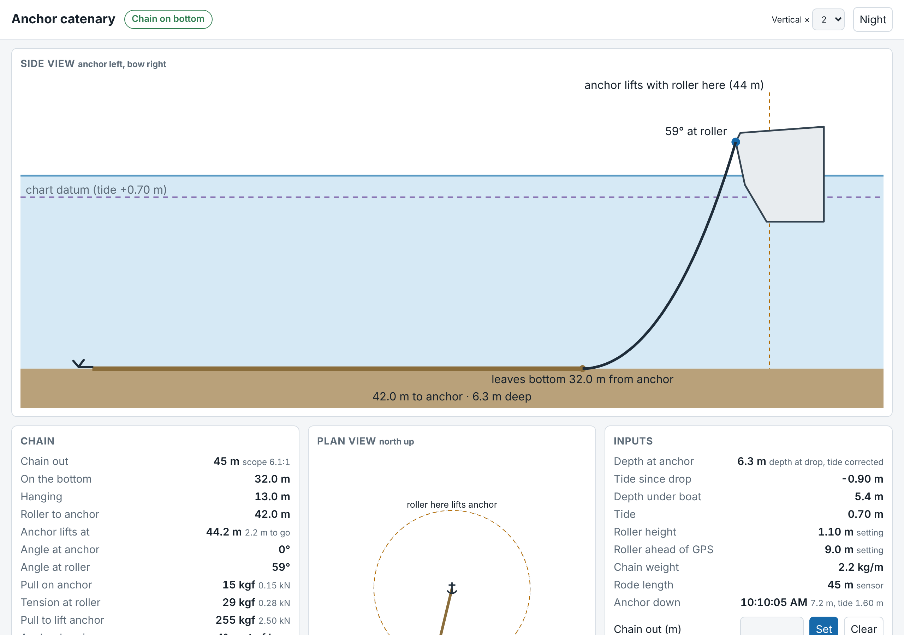

# signalk-anchor-catenary

A Signal K server plugin and webapp that shows how your anchor chain is lying right now, while you are at anchor:

- how much chain lies on the bottom, and where it leaves the bottom
- whether the chain is lifting the anchor shank, and at what angle
- the chain angle and tension at the bow roller, and the horizontal pull on the anchor
- how far the boat can fall back before the chain starts lifting the anchor, and the pull that takes



Anchor alarm plugins tell you when the boat has left its swinging circle. Scope calculators tell you how much chain to put out.
This plugin fills the gap between the two. From the anchor position, the boat's position and heading, and the water depth at the
anchor, it works out the shape the chain must be hanging in.

## How it works

The horizontal distance from the bow roller to the anchor, the height of the roller above the seabed and the length of chain out
fix the shape of the chain completely. The chain hangs in a [catenary](https://en.wikipedia.org/wiki/Catenary).
The plugin solves for it and reports one of four states:

| State | Meaning |
|---|---|
| `slack` | The chain is long enough to hang straight down and lie all the way to the anchor. There is no horizontal pull. |
| `catenary` | Part of the chain lies on the bottom, and the rest hangs up to the roller. This is normal. |
| `lifting` | All the chain is off the bottom and pulls the anchor shank upwards. The anchor loses holding power. A warning notification is raised. |
| `taut` | The chain out is shorter than the straight line from the roller to the anchor. That's impossible, so the anchor position, rode length or depth is wrong. |

The tensions come from the chain's weight in water: steel loses about 13 % of its weight in sea water. They are the static tensions
needed to hold the boat where it is, not the snatch loads from waves or the boat sheering about.

### Water depth at the anchor, and the tide

The depth sounder measures the depth under the boat, which is up to 50 m from the anchor and can be quite different. The default
depth mode (`auto`) works like this:

1. When an anchor position appears (from [signalk-anchoralarm-plugin](https://www.npmjs.com/package/signalk-anchoralarm-plugin),
   [hoekens-anchor-alarm](https://www.npmjs.com/package/hoekens-anchor-alarm), WilhelmSK, Freeboard-SK or any other app that sets
   `navigation.anchor.position`), the plugin records the depth and the tide height at that moment.
2. From then on, the depth at the anchor = recorded depth − tide when recorded + tide now.
3. Without a tide value, the live sounder depth is used instead.

Any tide plugin that publishes `environment.tide.heightNow` works, for example
[signalk-tides-api](https://www.npmjs.com/package/signalk-tides-api) or [signalk-tides](https://www.npmjs.com/package/signalk-tides).

If you drop the anchor away from where the sounder was, press **Use depth here as depth at anchor** in the webapp when the
boat is over the anchor. Alternatively, set the depth mode to *charted depth* and enter the depth from the chart; the tide is
added to it.

The record is kept when the server restarts and cleared when the anchor position is set to `null` (anchor up).

## Inputs

| Input | Signal K path | |
|---|---|---|
| Anchor position | `navigation.anchor.position` | required |
| Boat position | `navigation.position` | required, position of the GPS antenna |
| Heading | `navigation.headingTrue`, else `navigation.headingMagnetic` + `navigation.magneticVariation` | needed when the roller is not at the antenna |
| Depth | `environment.depth.belowSurface`, else `belowTransducer` + `surfaceToTransducer` | configurable |
| Tide | `environment.tide.heightNow` | configurable, optional |
| Chain out | `navigation.anchor.rodeLength` | configurable; or enter it in the webapp |
| Roller position | setting, else `sensors.gps.fromBow` | metres forward (and to starboard) of the GPS antenna |
| Roller height | setting, else `design.bowAnchorRollerHeight` | above the waterline |
| Chain weight | setting | kg/m in air |

Position, heading and depth older than 60 s (configurable) are ignored.

## Outputs

Published under `navigation.anchor.catenary`, in SI units with metadata:

`state`, `horizontalDistance`, `rollerHeightAboveSeabed`, `waterDepth`, `rodeLength`, `scope`, `chainOnBottom`,
`suspendedLength`, `touchdownDistance`, `anchorAngle`, `rollerAngle`, `horizontalTension`, `rollerTension`, `liftDistance`,
`liftTension`, `bearingFromBow`.

`notifications.navigation.anchor.catenary` goes to `warn` when the chain lifts the anchor or the inputs disagree,
and back to `normal` afterwards. This can be turned off.

## Webapp

Open **Anchor Catenary** from the server's Webapps menu, or go to `http://<server>:3000/signalk-anchor-catenary/`.

- **Side view**: the chain from the anchor to the roller. Chain lying on the bottom is drawn brown. The dashed line marks where
  the roller would be when the anchor starts to lift. The vertical scale can be exaggerated.
- **Plan view**: the boat and the chain from above. The ring shows how far the roller can go before the anchor lifts.
- **Numbers** for everything above, with tensions in kgf and kN.
- **Inputs**: enter the chain out if you have no chain counter, enter a charted depth, or take the current depth as the depth at the anchor.
- Red **night** mode.

Setting values from the webapp needs a logged-in user if the server has security turned on.

## REST API

Under `/plugins/signalk-anchor-catenary`:

| | |
|---|---|
| `GET /state` | everything the webapp shows, including the chain profile as `[x, y]` points |
| `POST /rode` `{"length": 40}` | chain out in metres, `null` to clear |
| `POST /seabed` `{"depth": 6.5}` | charted depth at the anchor, `null` to clear |
| `POST /record` | take the current depth and tide as the depth at the anchor |

## Limitations

- The seabed is taken as flat between the anchor and the boat.
- Chain only: a rope rode or a snubber isn't modelled yet.
- Static: wave, sheer and current loads are not included. Use the lift distance and lift tension as margins, not as limits.

## Development

```bash
npm test
```

## License

Apache-2.0
